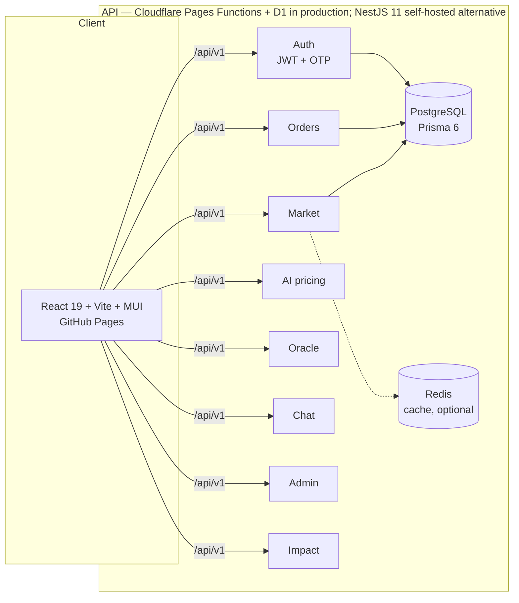

# KilimoLink Direct

**Hyperlocal food-resilience marketplace connecting Nairobi consumers directly with peri-urban farmers — every listing and order feeds a county resilience dashboard.**

[](https://github.com/geraldkombo/KilimoLink/actions/workflows/ci.yml)
[](https://geraldkombo.github.io/KilimoLink/)
[](LICENSE)
[](kilimolink/CONTRIBUTING.md)

**Live web app:** https://kilimolink.pages.dev — full mode: React SPA + API (Cloudflare Pages Functions) + D1 database, all same-origin.
**Mirror:** https://geraldkombo.github.io/KilimoLink/ (same live API; falls back to an offline demo dataset if it is unreachable).

The marketplace is the data engine: food-flow, price-gap and climate-impact signals aggregate into a live resilience view for Nairobi City County. Production runs entirely on the edge — https://kilimolink.pages.dev (SPA + API + D1 database, same origin).

---

## Why

Nairobi depends on surrounding counties for fresh food, and brokers capture 30–50% of the retail price between farm and plate. KilimoLink cuts that gap:

- **Farmers** list produce, get AI-suggested prices anchored to KNBS/AFA government reference prices, and see exactly what middlemen would have taken.
- **Consumers** buy fresh, local, traceable food at fair prices.
- **The county** gets real-time visibility into food flows and price risk before climate shocks become household crises.

## Features

| Area | What works |
|---|---|
| Marketplace | Product CRUD, pagination, search, category/county filters, distance ranking |
| Pricing AI | Heuristic price suggestion + `PRICE_TRUTH` reference table (KNBS/AFA bulletins, verified Oct 2026 supplier data) showing the broker gap per crop |
| Price oracle | Category-average snapshots calibrated to the KNBS 2026 Economic Survey |
| Orders & reviews | Full order lifecycle, buyer/seller reviews |
| Chat | Buyer–seller messaging |
| Auth | Email + JWT, phone OTP (bcrypt-hashed codes, throttling, lockout) |
| County dashboard | Resilience metrics aggregated from marketplace activity |
| Admin | Audit logs, user management, role-gated endpoints |
| Demo mode | Frontend falls back to a built-in localStorage dataset — no API needed |

## Architecture



- **Edge backend (production):** Cloudflare Pages Functions + D1 (SQLite) — same-origin with the SPA, WebCrypto JWT/PBKDF2, see `docs/EDGE_API.md`
- **Backend (self-host):** NestJS 11, TypeScript 5.7, Prisma 6 (PostgreSQL), Redis (graceful degradation), Swagger at `/api/v1/docs`
- **Web:** React 19, Vite 6, MUI 6, TanStack Query, Leaflet, Recharts
- **Tests:** 9 Jest e2e suites (backend) + Vitest (web)

## Repository layout

```
kilimolink/
  backend/     NestJS API (15 modules) + Prisma schema, seed data, tests
  web/         React SPA (8 routes) + demo-mode dataset
  mobile/      Expo scaffold (UI mockup)
  mcp-server/  MCP tool server (experimental)
  docs/        Architecture, deployment, data-refresh docs
render.yaml    Render blueprint: API + managed Postgres
.github/       CI (build + test) and GitHub Pages deploy workflows
archive/       Hackathon artifacts (prompts, pitch deck)
```

## Quick start

Prerequisites: Node 22, npm. (Postgres + Redis optional — see demo mode.)

```bash
# Backend
cd kilimolink/backend
npm install --legacy-peer-deps
copy .env.example .env        # set DATABASE_URL, JWT_SECRET
npx prisma generate && npx prisma db push
npm run prisma:seed           # demo farmers, products, KNBS sample data
npm run start                 # http://localhost:3000/api/v1 (Swagger: /api/v1/docs)

# Web (separate terminal)
cd kilimolink/web
npm install
npm run dev                   # http://localhost:5173
```

Without a database, the web app automatically serves its built-in demo dataset.

### Environment variables

| Variable | Purpose | Default |
|---|---|---|
| `DATABASE_URL` | PostgreSQL connection string | — |
| `JWT_SECRET` | Token signing. **Required in production — the app refuses to boot with a weak/missing secret when `NODE_ENV=production`** | dev-only fallback |
| `ADMIN_EMAILS` | Comma-separated emails granted ADMIN at login | empty |
| `REDIS_HOST` / `REDIS_PORT` | Cache | localhost:6379 |
| `DISABLE_REDIS` | Run without Redis | `false` |
| `MOCK_PAYMENTS` | Mock payment provider | `true` |

Full list: [`kilimolink/backend/.env.example`](kilimolink/backend/.env.example).

## Testing

```bash
cd kilimolink/backend && npm test      # Jest e2e: auth, market, orders, ai, oracle, chat, reviews, admin, health
cd kilimolink/web && npm run test      # Vitest: api client, demo dataset, AI descriptions
```

CI runs both suites plus production builds on every push (`.github/workflows/ci.yml`).

## Deployment

- **Production (edge):** Cloudflare Pages — SPA + API functions + D1 (SQLite) same-origin at https://kilimolink.pages.dev. See [`docs/EDGE_API.md`](kilimolink/docs/EDGE_API.md). Deploy: `cd kilimolink/web && npm run build && npx wrangler pages deploy dist --project-name kilimolink --branch master`.
- **API (self-hosted):** Render — `render.yaml` provisions the NestJS service + managed Postgres.
- **Web mirror:** GitHub Pages — `deploy.yml` builds `kilimolink/web` against the edge API on every push to `master`.
- **Docker:** `kilimolink/docker-compose.yml` runs the NestJS API + Postgres + Redis locally.

## Data sources

Price references combine official and field-verified data, refreshed Oct 2026:

- KNBS Food Price Monitoring & 2026 Economic Survey (beef retail Sh689.62/kg)
- AFA directorate bulletins (horticulture, dairy, honey)
- Ministry of Agriculture farmgate minimums (macadamia, Apr 2026)
- Verified supplier price lists, Laikipia/Nanyuki–Nairobi corridor (Oct 2026)

See [`docs/DATA_REFRESH.md`](kilimolink/docs/DATA_REFRESH.md) for the refresh pipeline.

## Security

See [`SECURITY.md`](kilimolink/SECURITY.md). Highlights: bcrypt password + OTP hashing with attempt throttling and lockout, helmet, rate limiting, JWT fail-fast in production, env-provisioned admins (no hardcoded role grants), payments mocked behind `MOCK_PAYMENTS`.

## Contributing

Read [`CONTRIBUTING.md`](kilimolink/CONTRIBUTING.md) and [`AGENTS.md`](kilimolink/AGENTS.md) (dev conventions). Every new feature ships with tests; TypeScript strict; API routes under `/api/v1`.

## License

MIT © 2026 KilimoLink Contributors — [LICENSE](LICENSE)
